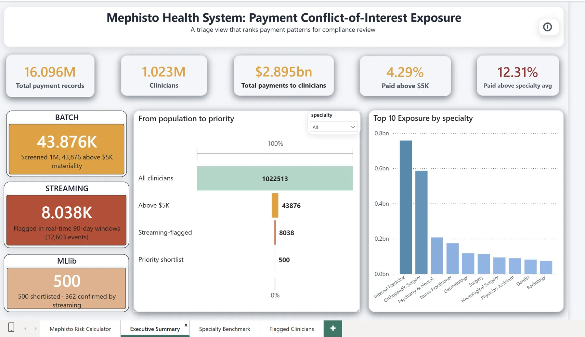
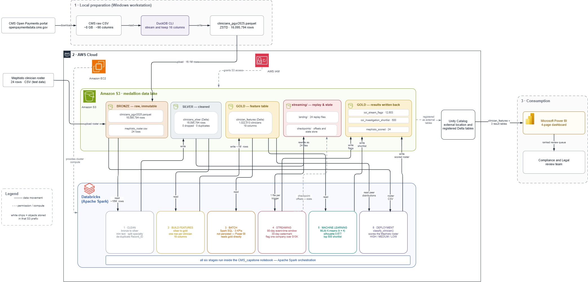
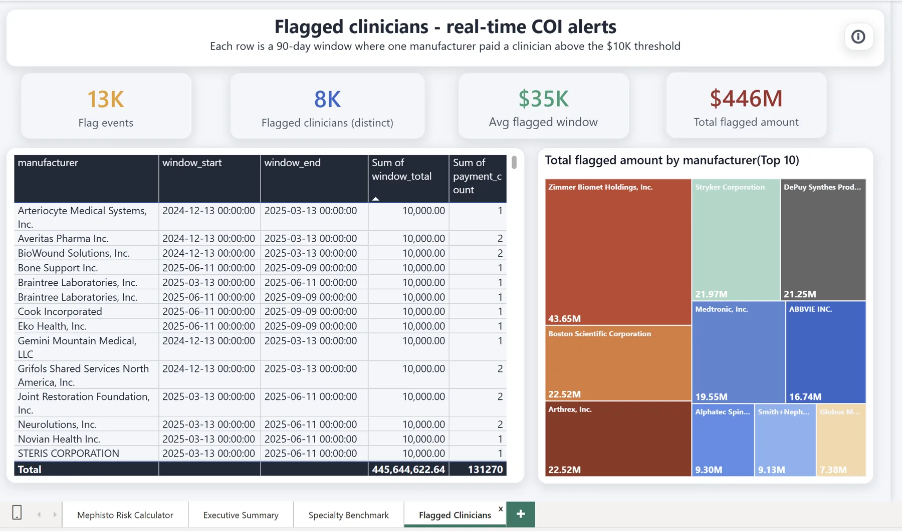
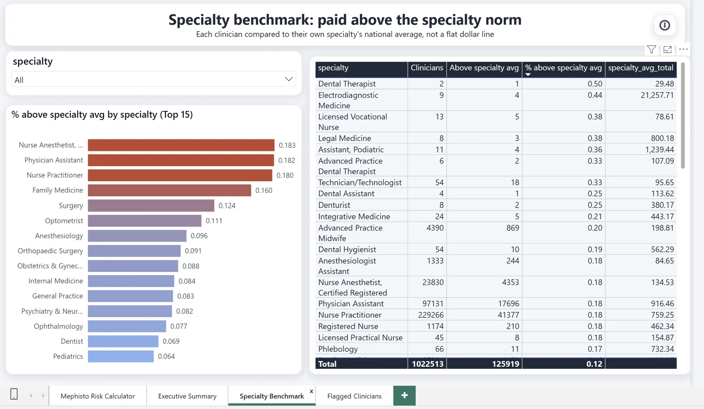
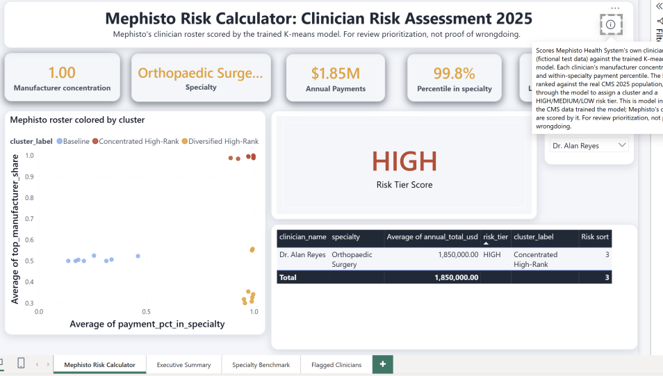

# Conflict-of-Interest Exposure in Payments to Clinicians

**A batch, streaming and machine learning pipeline on AWS and Databricks that takes 16 million real industry payments to U.S. clinicians and narrows them to a ranked list of 500 for compliance review. The health system it's built for, "Mephisto Health System," is fictional. The payments data is real.**

*Tools: DuckDB · Amazon S3 + IAM · Databricks · Apache Spark (PySpark, Structured Streaming, MLlib) · Delta Lake · Unity Catalog · Power BI · draw.io*



## The question

Drug and device companies pay clinicians all the time: consulting, speaking, meals, travel, royalties. Most of it is legitimate. The concern is when a lot of money moves from one company to one clinician, because then it's fair to ask whether that clinician still picks that company's product on clinical grounds alone.

Most health systems manage this with an annual self-attestation form. It looks backward, nobody can check it against anything, and it doesn't rank anyone. A compliance office that can review a few hundred people a year has no defensible way to choose which few hundred. I asked:

1. **Out of every paid clinician in the country, who should a compliance office look at first,** and can that choice be backed by evidence instead of gut feel?
2. **Can one pipeline do this three ways,** with batch indicators, near-real-time alerts and a model, all from the same curated data?

Final project, MS in Data Analytics & Business, Seattle Pacific University, Aug 2026.

## Data

- **Source:** [CMS Open Payments](https://openpaymentsdata.cms.gov), General Payments, Program Year 2025. U.S. federal public data, published under the Physician Payments Sunshine Act
- **Size:** about 8 GB of CSV, roughly 90 columns. I kept U.S. physicians and non-physician practitioners (nurse practitioners, PAs, dentists and so on), dropped teaching hospitals, and kept 16 columns. That's **16,095,794 payment records** to **1,022,513 clinicians**, worth **$2.89 billion**
- **Not in this repo:** the data. It's far too big for GitHub, and CMS refreshes it every year, so a copy here would go stale. Download it from the link above and trim it with the script in [`prep/`](prep/)
- **A note on real people:** Open Payments names real clinicians. Nothing in this repo identifies one: I removed every Profile ID and NPI from the notebook outputs, and the dashboard screenshots show companies, not people. The 24-clinician "Mephisto roster" in the risk calculator is test data I invented. The "Dr." names are made up, and any match to a real clinician is coincidence. As CMS itself says, a reported payment doesn't mean anyone did anything wrong. Nothing here is a finding about any clinician

## Methods



Everything after the local trim runs in one Databricks notebook, and the diagram matches it 1:1.

### 1. Local prep (DuckDB)
The raw CSV is streamed through the DuckDB command line on my laptop, filtered, cut to 16 columns and written as one ZSTD Parquet file (about 248 MB). Shrinking it before upload meant I wasn't paying to store and re-read 74 columns I'd never use. The file went to S3 as the bronze layer.

### 2. Medallion layers (bronze → silver → gold)
- **Bronze:** the Parquet file, never modified. 16,095,794 rows × 16 columns
- **Silver:** drop rows without a clinician ID or a positive amount, trim text, split the pipe-delimited specialty field into a broad group and a specific specialty, de-duplicate on `Record_ID`. **0 rows dropped, 0 duplicates.** Written as Delta
- **Gold:** one row per clinician (1,022,513 rows, 19 columns). The two families that matter are **concentration** (what share of a clinician's money came from their single biggest company) and **peer-relative rank** (their percentile within their own specialty). Validated with assertions on row count, nulls and 0–1 ranges before anything reads it

### 3. Batch: three indicators
Spark aggregations over gold: total payments, the share of clinicians paid over a $5,000 materiality line, and the share paid above their own specialty's average.

### 4. Streaming: single-company concentration alerts
Silver is rewritten as 24 files and replayed one file per trigger through Structured Streaming, so a static archive behaves like a feed. Each payment is placed by its payment date (event time), in **90-day tumbling windows** with a **30-day watermark**, keyed on clinician × manufacturer. A window is flagged when one company paid one clinician **$10,000 or more** inside it. Flags go to a Delta table with a checkpoint.

### 5. Machine learning: ranking peer deviation
There's no labeled data on who actually had a conflict, so this is unsupervised. K-means (Spark MLlib) runs on just two features, both already on a 0–1 scale: percentile within specialty, and single-company share. I left raw dollars out on purpose, because $30,000 is normal for an orthopedic surgeon and extraordinary for a pediatrician. I tried k = 2 to 8 and kept k = 4 (best silhouette). The cluster closest to "low rank, spread across companies" becomes the baseline, and every clinician is scored by distance from its center. The top 500 become the review shortlist.

### 6. Deployment and dashboard
`classify_clinician()` takes a specialty, an annual total and the biggest single-company amount. It computes the same two features against the national specialty distribution, assigns the nearest cluster and returns HIGH, MEDIUM or LOW, checking itself against the trained Spark model each time. I ran it on the invented 24-person roster and wrote the results back to gold. Power BI reads the gold tables through Unity Catalog. I first tried to run the model inside Power BI and it kept breaking, so scoring stays in the notebook and Power BI just reads the scored table.

| | |
|---|---|
|  |  |
| **Streaming alerts:** each row is a 90-day window where one company paid a clinician over $10K. Manufacturers only, no clinician IDs | **Specialty benchmark:** each clinician compared to their own specialty's average, not a flat dollar line |


**Risk calculator:** the trained model applied to the invented Mephisto roster. For review prioritization, not proof of wrongdoing.

## Key result

> **The pipeline works end to end on real data at real scale: 16.1 million payments in, a ranked list of 500 clinicians out, a 2,045-to-1 reduction a small compliance team could actually work through. But the ranking is a transparent rule more than a discovery: it puts at the top whoever is high in their own specialty with most of their money from one company.**

- **Batch:** $2,894,883,382.23 in total. Only **43,876 clinicians (4.29%)** received over $5,000, and **125,919 (12.3%)** were paid above their own specialty's average. The money is broad and shallow, and peer comparison changes the picture: the average orthopedic surgeon gets about $23,500 a year, about five times the average internist ($4,883). A flat dollar threshold would fill the queue with orthopedic surgeons behaving normally for their field.
- **Streaming:** **12,603 flagged windows covering 8,038 clinicians** (0.79% of the population) and $445.6 million (15.4% of all the money). Device makers dominate. Zimmer Biomet alone accounts for $43.65 million of flagged value, about twice the next company.
- **Machine learning:** k = 4 scored a silhouette of **0.677** (0.61 to 0.68 across k = 2 to 8). The four clusters map onto the two axes: concentrated high-rank (HIGH), diversified high-rank (MEDIUM), concentrated low-rank (MEDIUM) and baseline (LOW). All 500 shortlisted clinicians fall in the concentrated high-rank cluster. One caveat: silhouette says the 2-D space splits cleanly into four groups. It says nothing about whether anyone has a conflict.
- **The two methods overlap, but that isn't independent proof.** 362 of the 500 shortlisted clinicians (72%) were also flagged by the streaming rule, calculated in Power BI. Both methods reward a lot of money from one company, so a big overlap is mostly built in.
- **Deployment:** all 24 roster clinicians were scored and none were skipped: 8 HIGH, 8 MEDIUM, 8 LOW.

**Limitations:** Open Payments records what was paid, not what was prescribed or implanted, so this shows exposure, never influence. It's one program year, general payments only (no research payments or ownership stakes). The $5K line, $10K trigger, 90-day window and 500 cutoff are policy choices, not derived from anything.

## What I'd do differently

- **Close the last streaming windows.** In append mode, Spark only writes a window once the watermark passes its end, and an `availableNow` run stops without flushing what's still open. In the saved run the watermark finished at Dec 1, 2025, so windows ending later than that never got written. That means payments from about Sep 9 to the end of 2025 couldn't raise a flag. For a replayed archive, the fix is to push one late dummy event through at the end, or use update mode and dedupe.
- **Name clusters from the model, never from a remembered run.** I first hard-coded cluster names by ID. When the model was refit, the IDs renumbered and three of the four names landed on the wrong clusters, which showed up as a roster with zero LOW tiers. The fix (now in the notebook) names each cluster from where its center actually sits. The notebook here was last saved before that fix ran, so I cleared the outputs it affected. The final numbers are in the report.
- **Compute every dashboard number in the notebook.** The 8,038 distinct flagged clinicians, the 362 overlap and the 125,919 above average were all calculated in Power BI. Every number should trace back to a cell.
- **Make the two methods actually independent,** or stop calling their overlap corroboration. A second detector built on different evidence, such as how payment *types* change over time, would make agreement mean something.

## View it

- **No install:** the [report (PDF)](docs/report.pdf) has the full write-up, results and appendices · the [notebook](notebook/cms_capstone_pipeline.ipynb) shows on GitHub with its code and the saved outputs that don't identify anyone · dashboard screenshots in [`images/`](images/) · diagram in [`architecture/`](architecture/) (open the `.drawio` file at [app.diagrams.net](https://app.diagrams.net))
- **To run it:** you need a Databricks workspace and an S3 bucket it can read and write.
  1. Download the General Payments PY2025 CSV and run [`prep/trim_open_payments.sql`](prep/trim_open_payments.sql) in DuckDB
  2. Upload the Parquet file to `bronze/` in your bucket, plus a roster CSV with columns `clinician_name, specialty, annual_total_usd, biggest_company_usd`
  3. Set `BUCKET` in the notebook's first code cell and run it cell by cell. Don't use "Run all": it re-runs the stream

## Repo layout

```
├── notebook/
│   └── cms_capstone_pipeline.ipynb     # the whole pipeline: medallion layers, batch, streaming, ML, deployment
├── prep/
│   └── trim_open_payments.sql          # DuckDB trim (rebuilt; I ran the original by hand)
├── architecture/
│   ├── architecture.png                # AWS architecture diagram
│   └── cms_capstone_architecture.drawio
├── images/                             # Power BI dashboard screenshots
└── docs/
    └── report.pdf                      # full project report
```

---
*Brenda Kinoti · [Portfolio](https://brendakinoti-datascientist.netlify.app) · MS Data Analytics & Business, Seattle Pacific University*
